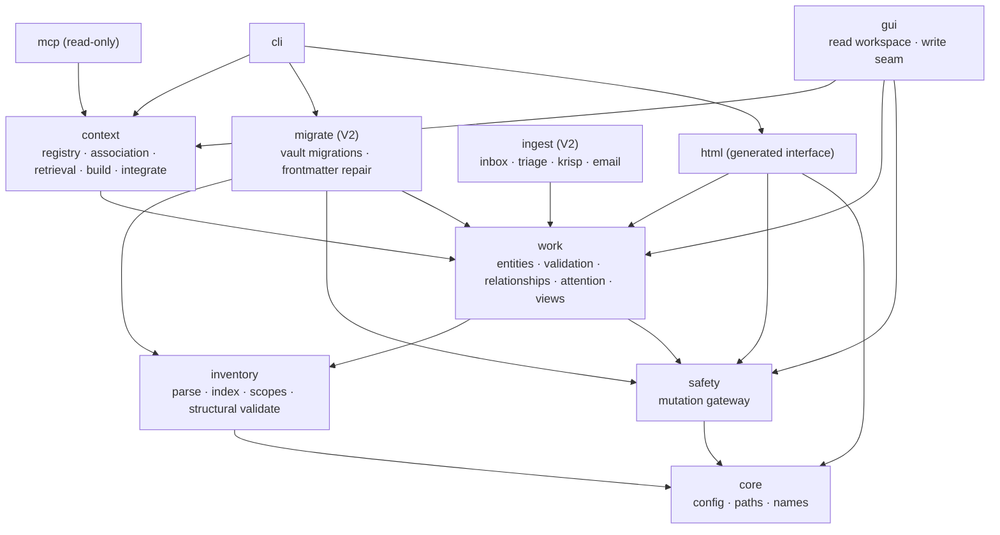

# WorkSync Architecture

The target package layout and one-way dependency direction for the merged platform.
Layer names come from [ADR-0001](adr/0001-domain-layer-decomposition.md); the
`inventory` split is [ADR-0003](adr/0003-single-scanner-parse-and-index.md); the
`core`/`safety` foundations are [ADR-0004](adr/0004-core-and-safety-foundations.md).

## Layers

Arrows point from a package to what it depends on.

## Package responsibilities

| Package | Responsibility | V1 |
|---|---|---|
| `core` | Machine config + secrets loading, vault root/containment/legacy-path rebase, safe-name and unique-target helpers. No internal dependencies. | yes |
| `inventory` | The single vault reader: `parse` (`IndexRecord`, YAML-faithful frontmatter read/write, headings/tags/links/tasks) and `index` (SQLite/FTS, incremental update, `fts_repaired`, `index_outdated`), config-driven scopes, structural/health validation. Read-only. | yes |
| `safety` | The single mutation gateway: `backed_up_write`, `rollback_backed_up_write`, `settled_snapshot`, atomic write preconditions, and the narrow `derived` seam for non-canonical runtime writes. No internal dependencies beyond `core`. | yes |
| `work` | Work-management semantics: typed entities (`project`/`person`/`ticket`/`meeting`/`action`), schema detection, entity validation, relationships, attention/rollups, generated views, deterministic rendering, contained view writer, the canonical action write service (allowlisted edits and quick completion as one `safety.commit` transaction), the five-slot workday plan with steering, and the shared review-queue primitive (`work.queue`) with the duplicate and clarification review→commit pipelines. | yes |
| `migrate` | Vault migrations: detection and reviewable repair of malformed frontmatter, and normalization of work-entity frontmatter to the reconciled schema. Reads through `inventory` and the `work` mapping, writes only through the `safety` gateway; never adds a parser and never imports `context`. | V2 |
| `context` | Retrieval and evidence: managed-repo registry and availability, membership vs relevance vs authority, the retrieval service (resolve/search/read/staleness), generated project context, managed-block integration. | yes |
| `ingest` | Raw-to-staged-to-canonical ingestion and review/promotion: inbox, triage, inbox triage, backfill, routing, Krisp, email; PDF/Patron deferred. | V2 |
| `html` | The generated HTML interface: the one link contract, a pure deterministic generator of self-contained pages from already-resolved entities, and a contained derived writer into the `generated` zone (`0. System/Interface/`). Imports no `context`; no JavaScript, no forms, no second parser. | V2 |
| `cli` | Unified console entry points over the layers. | yes |
| `gui` | The interactive workspace: read-only dashboards and entity detail over the retrieval service, plus the write seam `POST /api/action/<name>` that dispatches named actions to `work`/`ingest` services and commits through `safety`. No business rules in the GUI or its JavaScript; it never sets `force`. | yes |
| `mcp` | Read-only stdio MCP adapter over `context`. No write helpers. | yes |

## Dependency rules

- `core` depends on nothing.
- `inventory` and `safety` depend only on `core`.
- `work` depends on `core`, `inventory`, `safety`.
- `migrate` depends on `core`, `inventory`, `safety`, and `work` (for the single schema
  mapping); it never imports `context` or a write helper, so the parser stays pure and
  the gateway stays the only write seam.
- `context` and `ingest` depend on `work` (and therefore on the foundations).
- `ingest` additionally reads through `inventory.parse` and writes only through
  `safety`; it never imports `context` or `html`. The model provider it consults lives
  in `core` precisely so this stays true (see [local-model.md](local-model.md)).
- `html` depends on `core`, `safety`, and `work` only; it never imports `context`, so
  the interface consumes resolved entities and can be split into its own repository
  later. The `cli` orchestrates the reads and passes entities into `html`.
- `cli`, `gui`, `mcp` are consumers and depend on the layers.
- `gui` is the interactive write client: its read controller calls the retrieval service
  and reaches no write helper, while its write seam (`gui.actions`) dispatches named
  actions to `work`/`ingest` services that build one `safety.commit` transaction. The
  GUI holds no domain logic, and the generated HTML layer stays a zero-JavaScript read
  surface. See [ADR-0017](adr/0017-gui-interactive-write-client.md).
- Dependency direction is one-way; no cycles. `inventory` never imports `work`,
  `context`, or `ingest`. `safety` never imports a domain layer.
- Within `context`, the retrieval layer (`registry`, `projection`, and the future
  `search`/`evidence`) is read-only: it opens the index `mode=ro` and imports no write
  helper. `context.association` is the sole derived-index writer; it builds membership
  rows purely and persists them through an `inventory`-owned derived-write adapter.
  See [ADR-0013](adr/0013-read-only-boundary-scope.md).
- No GUI-only business rules: `gui` calls `work`/`context` services.

## Ingest pipeline

`ingest` turns raw sources into reviewed canonical writes without a second parser or a
second write seam. It reads through `inventory.parse`, resolves entities through
`work`, and reaches `safety` for every write; it imports no `context` and no `html`.

1. **Discover** — `ingest.discover` finds candidate sources under the configured roots
   (inbox, rough notes) using the single `inventory.parse` scanner.
2. **Enrich** — `ingest.enrich` runs deterministic rules first and, for each candidate
   source, always produces a complete `Proposal` (a non-action or untitled source yields
   no proposal). An optional injected `Suggester` (the `core.model` provider seam) only
   fills weak fields as suggestions with capped confidence and provenance; the
   deterministic path never depends on the model.
3. **Review** — `ingest.service.scan` merges fresh proposals into the staging manifest
   and persists it through `safety.derived` with a stale-state precondition, so a
   first-create race or a concurrent tab fails closed. Review edits, dismissals, and the
   reviewer/reason are persisted the same way.
4. **Apply** — `ingest.apply` builds one `ChangeSet` for a reviewed batch (the canonical
   creates/updates/moves plus the manifest update) and commits it through
   `safety.gateway.commit`. A batch either commits coherently or restores its prior
   state; a source is disposition-moved only after its destination write succeeds and a
   recoverable backup exists.

See [`docs/mutation-contract.md`](mutation-contract.md) for how an ingest batch uses the
same gateway as any other canonical write.

## Review queues pipeline

`work.duplicates` and `work.clarification` are two review-first workflows over
already-canonical `action` notes, built on one shared primitive (`work.queue`). They read
through `inventory.parse` and `work` semantics, reach `safety` for every write, and import
no `context` or `html` (see [ADR-0018](adr/0018-shared-review-queue.md)).

1. **Detect** — `work.duplicates.discover_duplicates` scores active action pairs with the
   shared `work.similarity` scorer plus evidence bonuses for a shared project, owner, and
   title terms; `work.clarification.discover_clarifications` is a pure predicate over
   canonical fields (no project/owner, invalid priority, past-due non-terminal). Neither
   detector writes; each returns `Proposal`s, and detection holds no model dependency.
2. **Queue** — each concern's `scan` merges fresh proposals into a `staging` manifest with
   a stale-state precondition through `work.queue`, so a first-create race or a concurrent
   tab fails closed. A retained decision is honored only while its basis matches; a basis
   change voids it back to `pending` with history; an undiscovered pending proposal is
   retired as `obsolete`. An explicit dismissal records a named reviewer and reason.
3. **Apply** — each concern's `apply` selects the pending proposals, re-checks every
   basis/SHA precondition up front, builds the canonical operations, appends the
   primitive's manifest-update operation, and calls `safety.gateway.commit` once. A merge
   or archive is a destructive verb and requires confirmation. A mid-batch failure rolls
   back in reverse order and leaves the vault byte-identical. The manifest is the decision
   ledger; there is no separate rejection or decision file. A clarification `keep` also
   appends one deterministic bullet to the note's `## Updates` section in the same
   transaction; a `waiting-on` reclassify requires a current team owner (an active person
   with a `team` field set).

The GUI exposes both pipelines through the existing write seam
(`duplicates-scan`/`duplicates-apply`/`duplicates-dismiss` and
`clarification-scan`/`clarification-apply`), and the CLI mirrors every action. The shared
queue screen carries the `Review` nav label; the pre-existing project board is labelled
`Board` so the two are not confused.

## Source mapping

| Source | Destination |
|---|---|
| `obsidian_inventory.scanner`, `vault_indexer` | `inventory` (`parse` + `index`) |
| `mutation_safety` | `safety` |
| `constants`, `vault_paths`, `names`, config loading | `core` |
| `obsidian_operator.*`, `team_command_center` task model | `work` |
| `context_service`, `project_association`, `project_build`, `project_integrate`, `mcp_server` | `context` + `mcp` |
| `obsidian_librarian.*`, `obsidian_patron.*`, `triage`, `inbox_triage`, `note_backfill`, `note_route`, `krisp_*`, email intake | `ingest` |
| `worksync_ui`, operator/librarian GUIs | `gui` |
