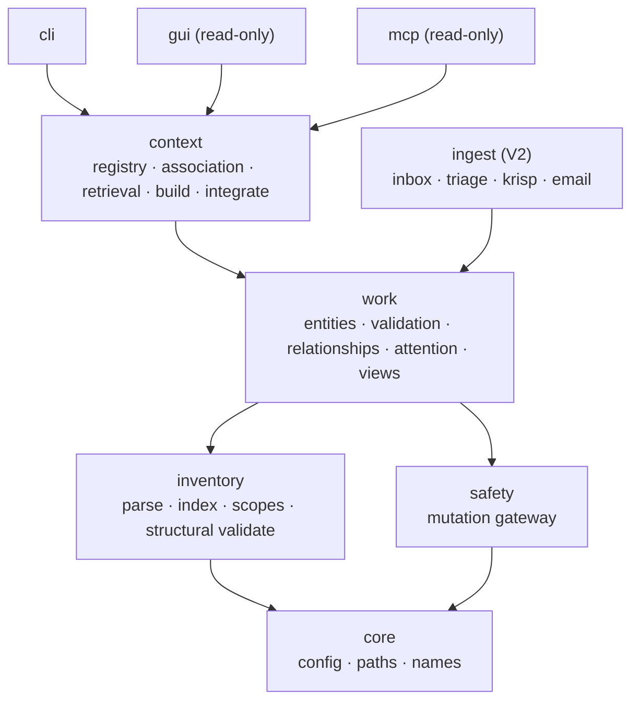

# WorkSync Architecture

The target package layout and one-way dependency direction for the merged platform.
Layer names come from [ADR-0001](adr/0001-domain-layer-decomposition.md); the
`inventory` split is [ADR-0003](adr/0003-single-scanner-parse-and-index.md); the
`core`/`safety` foundations are [ADR-0004](adr/0004-core-and-safety-foundations.md).

## Layers

Arrows point from a package to what it depends on.

## Package responsibilities

| Package | Responsibility | V1 |
|---|---|---|
| `core` | Machine config + secrets loading, vault root/containment/legacy-path rebase, safe-name and unique-target helpers. No internal dependencies. | yes |
| `inventory` | The single vault reader: `parse` (`IndexRecord`, YAML-faithful frontmatter read/write, headings/tags/links/tasks) and `index` (SQLite/FTS, incremental update, `fts_repaired`, `index_outdated`), config-driven scopes, structural/health validation. Read-only. | yes |
| `safety` | The single mutation gateway: `backed_up_write`, `rollback_backed_up_write`, `settled_snapshot`, atomic write preconditions. No internal dependencies beyond `core`. | yes |
| `work` | Work-management semantics: typed entities (`project`/`person`/`ticket`/`meeting`/`action`), schema detection, entity validation, relationships, attention/rollups, generated views, deterministic rendering, contained view writer. | yes |
| `context` | Retrieval and evidence: managed-repo registry and availability, membership vs relevance vs authority, the retrieval service (resolve/search/read/staleness), generated project context, managed-block integration. | yes |
| `ingest` | Raw-to-staged-to-canonical ingestion and review/promotion: inbox, triage, inbox triage, backfill, routing, Krisp, email; PDF/Patron deferred. | V2 |
| `cli` | Unified console entry points over the layers. | yes |
| `gui` | Read-only local workspace (dashboards, entity detail); write interactions in V2. | yes (read-only) |
| `mcp` | Read-only stdio MCP adapter over `context`. No write helpers. | yes |

## Dependency rules

- `core` depends on nothing.
- `inventory` and `safety` depend only on `core`.
- `work` depends on `core`, `inventory`, `safety`.
- `context` and `ingest` depend on `work` (and therefore on the foundations).
- `cli`, `gui`, `mcp` are consumers and depend on the layers.
- Dependency direction is one-way; no cycles. `inventory` never imports `work`,
  `context`, or `ingest`. `safety` never imports a domain layer.
- No GUI-only business rules: `gui` calls `work`/`context` services.

## Source mapping

| Source | Destination |
|---|---|
| `obsidian_inventory.scanner`, `vault_indexer` | `inventory` (`parse` + `index`) |
| `mutation_safety` | `safety` |
| `constants`, `vault_paths`, `names`, config loading | `core` |
| `obsidian_operator.*`, `team_command_center` task model | `work` |
| `context_service`, `project_association`, `project_build`, `project_integrate`, `mcp_server` | `context` + `mcp` |
| `obsidian_librarian.*`, `obsidian_patron.*`, `triage`, `inbox_triage`, `note_backfill`, `note_route`, `krisp_*`, email intake | `ingest` |
| `worksync_ui`, operator/librarian GUIs | `gui` |
